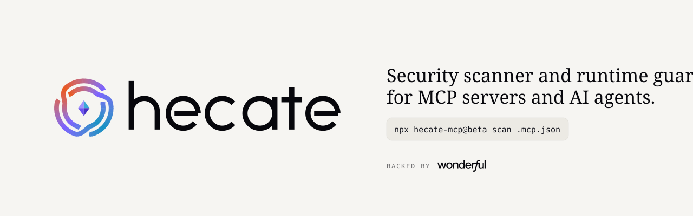

<picture>
  <source media="(prefers-color-scheme: dark)" srcset="brand/social/readme-banner-dark.svg">
  
</picture>

# Hecate

Security scanner and runtime guard for MCP servers and AI agents. Named for the Greek goddess of
gateways: a guard on the threshold between your agent and its tools. Runs entirely on your machine.

> **Beta.** Rules, output formats and the policy file may change before 1.0.

```bash
npx hecate-mcp@beta scan tools.json            # find poisoned, over-scoped or risky tools
npx hecate-mcp@beta scan fetch.json fs.json    # one file per server: some risks only show together
npx hecate-mcp@beta graph fetch.json fs.json   # lethal-trifecta attack graph (Mermaid)
npx hecate-mcp@beta pin tools.json             # approve: hash tool definitions into hecate.lock.json
npx hecate-mcp@beta check tools.json           # fail if a tool changed or appeared since (rug pull)
```

## What it catches

| Rule | Finds |
|---|---|
| MCP001 | **Tool poisoning:** hidden or injected instructions in a tool description |
| MCP002 | **Rug pull:** a tool changed, appeared or disappeared after you pinned it |
| MCP003 | **Tool shadowing:** a tool tells the model how another server's tools should behave |
| MCP004 | **Excessive scope:** command execution, file writes, the whole filesystem |
| MCP005 | **Lethal trifecta:** untrusted content + private data + a way to send it out |
| MCP006 | **Secrets** in a config or tool definition |
| MCP007 | **Known-bad servers**, or ones your policy doesn't allow |
| MCP008 | **Unpinned sources:** package versions, container images, plain-HTTP servers |

## Scan a whole agent

Point Hecate at an MCP client config: `mcpServers` (Claude Desktop, Claude Code `.mcp.json`,
Cursor, Windsurf) or `servers` (VS Code `.vscode/mcp.json`).

```bash
npx hecate-mcp@beta scan ~/Library/Application\ Support/Claude/claude_desktop_config.json --connect
npx hecate-mcp@beta pin .mcp.json --connect
npx hecate-mcp@beta check .mcp.json --connect
```

- `--connect` lists each server's tools by running it exactly as your client would: it starts the
  stdio servers and connects to remote ones (streamable HTTP or SSE, with the configured headers).
  An unreachable server fails the run (`--timeout <seconds>`, default 60).
- Without it, `scan` checks only the config itself (e.g. hard-coded secrets) and says which rules
  it skipped. `pin`, `check` and `graph` need the tools, so they require it.

## CI

Commit `hecate.lock.json` and run `hecate check`. Exit codes: `0` clean, `1` critical or high
findings, `2` input error.

`scan` and `check` take `--format pretty|json|sarif` (`--json` for short). SARIF results point at
the tool's line in a tools file, or the server's entry in a client config; accepted findings carry
the policy reason as a suppression.

```yaml
- run: npx hecate-mcp@beta scan .mcp.json --connect --format sarif > hecate.sarif
- uses: github/codeql-action/upload-sarif@v3
  if: always() # hecate exits 1 on critical/high findings
  with:
    sarif_file: hecate.sarif
```

## Policy: `hecate.policy.json`

Read from the working directory, or pass `--policy <path>`. Every entry needs a `reason`; unknown
keys and rule IDs are errors.

```json
{
  "version": 1,
  "capabilities": [
    { "server": "fetch", "tool": "fetch", "external-comms": false,
      "reason": "Egress proxy only allows api.weather.gov" }
  ],
  "ignore": [
    { "rule": "MCP005", "expires": "2026-12-31",
      "reason": "Sandboxed agent, no credentials; reviewed by @alice" }
  ],
  "servers": {
    "allow": [
      { "package": "@modelcontextprotocol/*", "reason": "Official reference servers" },
      { "url": "https://mcp.linear.app/*", "reason": "Vendor-hosted, reviewed 2026-09" }
    ],
    "deny": [{ "package": "some-mcp-server", "reason": "Exfiltrates data, see INC-123" }]
  }
}
```

- **`capabilities`** corrects a tool's lethal-trifecta legs (omit `tool` for a whole server):
  `true` adds a leg, `false` removes one.
- **`ignore`** accepts a rule's findings, optionally for one `server` or `tool`. They're still
  listed but don't fail the run, until `expires` (UTC).
- **`servers`** decides which servers may run (MCP007), matching `package` (npm or PyPI, via npx,
  uvx, ...), `image`, `url` or `command`, with `*` wildcards. With an allowlist, every other server
  fails.

## Runtime guard: `@hecate-mcp/sdk`

Scanning finds risks before you connect; the guard enforces them inside your agent process. It
wraps MCP clients from the official TypeScript SDK (or any MCP transport), and one guard shared by
all of an agent's servers sees risks that span them.

```ts
import { Client } from "@modelcontextprotocol/sdk/client/index.js";
import { createGuard } from "@hecate-mcp/sdk";

const hecate = createGuard({
  policy: "hecate.policy.json", // uses its "guard" section
  lockfile: "hecate.lock.json", // from `hecate pin`
  approve: async ({ server, tool, reasons }) => askUser(`${server}/${tool}?`, reasons),
  audit: "hecate-audit.jsonl",
});
const github = hecate.wrap(new Client({ name: "agent", version: "1.0.0" }), { server: "github" });
await github.connect(transport); // listTools/callTool now go through the guard
```

- **Hides** tools the model mustn't see: definitions changed since pinning (without a lockfile,
  since the session's first `tools/list`), poisoned definitions, and tools the policy denies.
- **Blocks or asks** before risky calls: tools that run commands or code, anything matching
  `guard.approve`, and, once any tool has returned untrusted content, every tool that can send data
  out. That's the lethal trifecta, broken at runtime. Without an `approve` callback, these calls
  are blocked.
- **Keeps agents running:** a blocked call returns an `isError` result saying why.
  `mode: "monitor"` reports what it would do without enforcing.
- **Audits** one JSON line per list, call and result; arguments are stored as a SHA-256 unless
  `auditArguments` is set.

```json
{
  "version": 1,
  "guard": {
    "tools": { "deny": ["github/delete_*"] },
    "approve": ["*/send_*"],
    "egress": { "allow": ["*.github.com"] }
  }
}
```

`approveExec` and `approveEgressAfterUntrusted` default to `true`.

## Backers

<a href="https://www.wonderful.ai/">
  <picture>
    <source media="(prefers-color-scheme: dark)" srcset=".github/assets/backers/wonderful-dark.svg">
    
  </picture>
</a>

Thank you to **[Wonderful AI](https://www.wonderful.ai/)** for committing $4,500 to Hecate's development, after Hecate stopped
a phishing attempt against their MCP setup.

## Packages

| Package | npm | |
|---|---|---|
| [`packages/cli`](packages/cli) | [`hecate-mcp`](https://www.npmjs.com/package/hecate-mcp) | The scanner (`hecate` command) |
| [`packages/sdk`](packages/sdk) | [`@hecate-mcp/sdk`](https://www.npmjs.com/package/@hecate-mcp/sdk) | The runtime guard |
| [`packages/core`](packages/core) | bundled into both | Detection engine: pure, browser-safe |

Apache-2.0. For teams: [Hecate Cloud](https://hecate.protyoya.tech), now taking waitlist signups.
